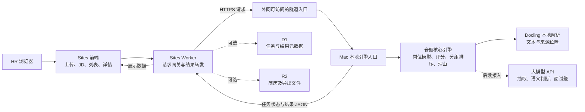

# 总体规划：Sites 前端与 Mac 本地仓颉引擎

> 规划日期：2026-11-02。本文确定 A 架构，作为后续实施依据；此前“预解析简历池 + 浏览器现场算分”的方案已作废。本文描述目标架构与待实现契约，不表示相关服务和页面已经上线。

## 1. 背景与目标

围绕招聘初筛，将简历与岗位要求组织成可追溯的匹配结果。HR 在网页上传简历、填写 JD，查看候选人列表、详情与推荐理由；计算由 Mac 本地仓颉引擎完成，网页展示引擎返回的 JSON。

目标是形成适合毕业设计演示的完整流程，保持仓颉核心逻辑与页面展示分离。已有本地解析、岗位结构体和确定性评分是实现基础；现场请求链路、JD 转换及语义能力需按本文继续实现，不据此宣称匹配准确率。

## 2. 整体架构



| 部分 | 职责 | 边界 |
| --- | --- | --- |
| Sites 前端 | 上传简历、填写 JD、提交请求、轮询状态、展示结果 | 不执行匹配计算，不持有引擎密钥或大模型密钥 |
| Sites Worker | 同源 API 网关、鉴权、文件访问授权、向 Mac 转发请求及查询结果 | 不解析简历，不转岗位模型，不计算分数或排名 |
| Mac 本地引擎 | 接收任务、解析简历、构建岗位模型、计算得分与分组排序、生成带证据的理由 | 计算与业务规则的唯一执行位置；以 JSON 返回结果 |
| 可选存储 | D1 保存任务、岗位快照和结果元数据；R2 保存文件 | 按需接入，不是新的计算服务；缓存不能代替引擎重新计算 |

Mac 入口是本地引擎的 HTTP 适配层，不另行部署独立后端服务器。仓颉通过本地命令调用 Docling；文档解码和 OCR 由 Docling 等本地工具承担。沿用已锁定的 SDK、stdx 与 Docling 版本，具体见 `toolchain.lock.json` 和 `requirements.lock`。

## 3. 数据流

1. HR 上传简历。Worker 校验文件并取得 `file_id`；可将原文件存入 R2，供引擎通过短期授权地址读取。
2. HR 填写 JD，提交本次候选文件集合。Worker 生成或接收请求标识，将请求经 HTTPS 隧道转发给 Mac。
3. Mac 接收任务，在本地执行文件读取、格式解析与结构化抽取，保留原文及来源位置；由引擎将 JD 转为四维岗位模型。
4. 岗位模型可供 HR 确认或修正；引擎在确认后冻结完整岗位快照与评估版本，再对本次所有候选人计算。
5. Mac 执行逐项判断、加权评分、必需条件分组、排序和理由组织，返回状态与结果 JSON。后续语义判断和面试题生成也由此处接入大模型 API。
6. Worker 将 JSON 返回前端，可把结果元数据写入 D1；前端按返回的分组和顺序展示，不重新算分或按分数重排。
7. JD、要求或权重改变时，建立新的评估版本并再次请求引擎；已确认有效的解析结果可在引擎内复用，不能直接复用旧评分。

解析和模型调用可能耗时，规划使用“提交任务 → 返回任务 ID → 轮询状态”的方式，避免一次长请求承担全流程。Mac 以本地文件记录任务状态，限制并发；不引入外部消息队列。重启后的任务应恢复到可识别状态或显式失败，不能一直显示处理中。

## 4. 接口契约

以下为拟实施的 API，不是当前已有接口。浏览器仅访问 Sites 的 `/api/*`；Worker 使用服务端配置的引擎地址与凭证访问 Mac `/v1/*`。引擎业务结果由 Worker 透传，前端不补造结论。

### 4.1 上传简历

`POST /api/files`，使用 `multipart/form-data`，字段 `file` 为简历文件。成功返回：

```json
{
  "file_id": "file-001",
  "filename": "candidate-001.pdf",
  "media_type": "application/pdf",
  "size_bytes": 12345,
  "status": "uploaded"
}
```

上传接口只接收和保存文件，不承诺解析成功。`file_id` 必须受当前访问身份约束；R2 对象地址不直接公开。接入 R2 时，Worker 在转发任务时为引擎提供限时、只读的 `download_url` 与 `expires_at`，不把存储凭证交给浏览器。引擎仅允许读取受控存储来源，不能接收任意内网或本机地址。

### 4.2 创建评估任务

`POST /api/evaluations` → Mac `POST /v1/evaluations`。

浏览器请求：

```json
{
  "schema_version": "1.0",
  "request_id": "request-001",
  "jd": {
    "title": "开发工程师",
    "text": "HR 在此填写岗位描述"
  },
  "resume_files": [
    { "candidate_id": "candidate-001", "file_id": "file-001" }
  ]
}
```

| 字段 | 含义 |
| --- | --- |
| `schema_version` | 数据契约版本；不兼容版本应拒绝 |
| `request_id` | 幂等请求标识；同一标识与相同内容不得重复创建任务，内容冲突应报错 |
| `jd.title` / `jd.text` | HR 填写的岗位名称和 JD，由引擎转换，不由浏览器推断 |
| `resume_files` | 本次评估文件集合；候选人与文件标识不可重复混淆 |

Worker 将 `file_id` 解析为受控文件下载信息后转发。Mac 接收成功返回 HTTP 202：

```json
{
  "schema_version": "1.0",
  "request_id": "request-001",
  "evaluation_id": "evaluation-001",
  "status": "queued",
  "job_model": null,
  "results": [],
  "error": null
}
```

### 4.3 岗位确认与任务查询

- `GET /api/evaluations/{id}` → Mac `GET /v1/evaluations/{id}`：查询状态、待确认岗位或最终结果。
- `POST /api/evaluations/{id}/confirm` → Mac 同路径 `/v1/.../confirm`：提交确认后的岗位模型，引擎重新校验并冻结。请求含 `request_id`、`job_revision`、`job_model`；模型字段与现有 `JobProfile` 对齐。

岗位模型含 `id`、`dimension_weights` 和 `requirements`。要求项含 `id`、`dimension`、`target_level`、`required`、`weight`；四维键为 `skills`、`experience`、`education`、`soft_quality`。已开始评分的快照不可原地修改，变更需新评估版本。

状态约定：`queued`、`running`、`awaiting_confirmation`、`succeeded`、`needs_review`、`failed`。`succeeded` 仅表示本次流程完成，逐项仍可能待核实；不能作为自动录用结论。当前 JD 转换、抽取或语义适配器未实现时，必须明确返回待处理或不可用状态，不能把原始 JD 当作已生成的岗位模型。

最终返回结构示例（示意未知结果，不是实际匹配结论）：

```json
{
  "schema_version": "1.0",
  "request_id": "request-001",
  "evaluation_id": "evaluation-001",
  "status": "needs_review",
  "job_revision": "revision-001",
  "results": [
    {
      "candidate_id": "candidate-001",
      "mandatory_status": "待核实",
      "total_score": 0,
      "dimension_scores": {
        "skills": { "score": 0 },
        "experience": { "score": 0 },
        "education": { "score": 0 },
        "soft_quality": { "score": 0 }
      },
      "evidence_coverage": 0,
      "items": [
        {
          "requirement_id": "requirement-001",
          "dimension": "skills",
          "target_level": "岗位确认后的目标要求",
          "status": "待核实",
          "score": 0,
          "evidence": [],
          "reason": "未知，需核实"
        }
      ],
      "strengths": [],
      "gaps": [],
      "pending": [
        {
          "requirement_id": "requirement-001",
          "dimension": "skills",
          "target_level": "岗位确认后的目标要求",
          "status": "待核实",
          "score": 0,
          "evidence": [],
          "reason": "未知，需核实"
        }
      ],
      "review_status": "待人工复核"
    }
  ],
  "interview": { "status": "not_implemented", "items": [] },
  "error": null
}
```

本例省略完整 `job_model`、冻结快照、计数及部分要求项，正式返回应包含可复现的完整数据：顶层 `job_model` 为确认后的岗位模型；每个候选的 `evaluation` 为现有 `FrozenJob.toJson()` 产生的 `revision` 与 `profile` 快照，另保留 `covered_requirements` 和 `requirement_count`。候选结果沿用现有 `evaluate` 的字段；`pending`、`strengths`、`gaps` 均为对应 `items` 中的完整逐项结果对象数组。推荐理由引用的 `evidence` 包含证据 ID、维度、能力值、原文 `quote` 和来源 `source`；来源保留可获得的引用、段落、页码或 bbox。返回 `results` 顺序即引擎排名顺序。

### 4.4 错误与失联

错误统一使用 `error: { code, message, retryable }`，包含 `request_id`；不得把失败转换成“零分候选人”。上传校验失败用 4xx，引擎失联用 503、网关等待超时用 504；任务已创建后的业务失败通过任务状态和错误字段展示。重试复用幂等标识，不重复排队。

已有 D1 缓存可供查看历史结果，但须标明历史版本与时间；不能伪装为当前在线计算。后台密钥不进入 JSON 响应，日志不记录完整简历或大模型凭证。

## 5. 页面与功能

| 页面 / 区域 | 功能 |
| --- | --- |
| 简历上传 | 选择文件、查看上传状态，关联候选人与文件；不在页面解析文档 |
| 岗位录入与确认 | 填写 JD，展示引擎生成的四维模型，确认或修正要求与权重后提交引擎 |
| 候选人列表 | 按引擎顺序展示组别、总分、四维分与证据覆盖率，显示任务进度和失败状态 |
| 候选人详情与理由 | 展示要求项、原文来源、优势、缺口和待核实项，不在浏览器重建结论 |
| 面试题区域 | 当前显示接口占位；以后展示引擎生成的问题、依据与追问 |

页面显示的筛选与搜索仅影响可见范围，不改变原始评分、分组或排名。未经确认的岗位版本和历史结果应有清晰区分。

## 6. 评分规则

仓颉实现为规则依据，Sites 不另写计算实现。

设维度为 `d`，其要求项为 `i`，项权重为 `w_i`，项得分为 `s_i`，维度权重为 `W_d`：

```text
维度分 D_d = Σ(w_i × s_i) / Σ(w_i)
总分 S = Σ(W_d × D_d)
```

- 技能、经验、学历、软素质四维，项得分、维度分及总分范围为 0–100；维度权重之和为 1，在评估前冻结。
- 未知项得 0 分，但项权重仍保留在分母；空维度计 0，不向其他维度重新分配权重。
- 必需项任一不满足则整组不满足；否则存在待核实则待核实；其余满足。没有必需项时视为通过该门槛，不代表推荐或录用。
- 先满足组、再待核实组、再不满足组；组内按总分降序，同分保留输入顺序；不同冻结版本不能混排。
- 证据覆盖率为有有效引用的要求项数除以全部要求项数，不等同于满足率。无有效证据不得产生确定的满足或不满足结论。
- 理由由引擎根据逐项结果与原文证据组织；未知列为待核实。姓名、性别、年龄不参与评分。

具体计算、校验与结果字段参照 `src/job_model/model.cj`、`src/matching_agent/scoring.cj` 和 `docs/matching-implementation.md`。语义适配器未接入时继续保持未知、待核实，不用模板文字冒充真实能力判断。

## 7. 不包含的东西

- 浏览器端评分、分组、排名计算或独立语义推断。
- 独立部署的后端服务器；仅使用 Sites 自带 Worker 网关与 Mac 本地引擎入口。
- 让 Sites Worker 直接访问 Mac 的 `localhost`，或绕过隧道的内网地址。
- 前端直接调用大模型 API、保存引擎密钥或大模型密钥。
- 当前阶段的生产级高可用、独立数据库服务器、向量库、消息队列和模型训练。
- Mac 离线时继续执行新计算，或将预存结果包装为现场计算。

可选的 D1 和 R2 属于站点存储能力，不等于另建数据库服务器或业务后端。

## 8. 硬前提与风险

| 前提 / 风险 | 对演示的影响与处理 |
| --- | --- |
| Mac 必须在线且经隧道可被外网访问 | Worker 运行在云端，访问不了 Mac 的 `localhost`；需配置真实 HTTPS 引擎入口并从 Worker 侧验证连通性 |
| Mac 睡眠、关机、断网或隧道退出 | 站点无法完成新的引擎业务请求；静态页面或历史缓存可能仍可打开，但不代表计算可用；需显示不可用状态 |
| 单机依赖 | 毕业演示规模够用，生产不够稳定；演示前检查供电、网络、进程及隧道，保持 Mac 唤醒 |
| 隧道地址、鉴权与站点绑定 | 地址稳定性、访问策略、Worker 出站访问及 D1/R2 绑定需实施验证，不能把浏览器能访问等同于 Worker 能访问 |
| 解析与模型调用耗时 | 采用任务状态轮询、超时与幂等重试，限制文件规模与并发；不依靠一次长请求永久等待 |
| 语义接口与端到端链路尚待实现 | 当前本地模块通过不等于网页现场链路已经完成；JD 转模型、语义适配、任务入口必须分别验收 |
| 文件与结果泄露、过期授权 | 使用脱敏演示数据、受控下载、短期授权与服务端密钥，明确文件清理和结果访问范围 |

## 9. 实施步骤

1. **固定契约与模块边界**：对齐任务、岗位快照、证据及匹配 JSON，规范未知、错误和版本字段，保留现有仓颉测试。
2. **封装 Mac 引擎入口**：增加本地 HTTP 适配与任务状态，串联 Docling 解析、岗位模型和现有评分；先验证提交、查询及失败处理。
3. **补齐引擎能力**：实现 JD 转岗位模型及确认流程，接入结构化抽取与语义判断；模型调用放在引擎侧，校验字段、分值和证据。
4. **接通隧道与 Worker**：配置鉴权、文件传递和真实 HTTPS 入口，验证 Worker 到 Mac 的请求、失联、超时及重试；按需接入 D1/R2。
5. **实现 Sites 页面**：完成上传、JD、岗位确认、列表和详情，以引擎返回 JSON 为展示依据，面试区保留占位直至引擎功能完成。
6. **完成演示与后续验证**：以脱敏样例贯通现场请求，核对网页结果与仓颉输出一致；检查断网、睡眠及失败状态。面试能力与评估另按实际进展推进，实验结果产生前不写效果结论。

## 10. 论文边界与现有文档关系

仓颉版是核心引擎：负责业务数据结构、解析编排、岗位转换、匹配计算、分组排序和理由校验。Sites 是展示与请求入口，Worker 是转发层；本方案没有浏览器算分移植。底层文档解析依赖 Docling，后续语义判断与面试生成依赖引擎侧的大模型 API，应如实说明这些技术分工。

`docs/technical-solution.md` 用于课题与模块定义，`docs/local-validation.md` 和 `docs/matching-implementation.md` 用于已有实现与验证记录。网页部署及现场请求链路以本文的 A 架构为后续实施依据；历史记录不作为已上线服务的证明。本次仅沉淀总体规划，不改演示文件、不部署服务。
